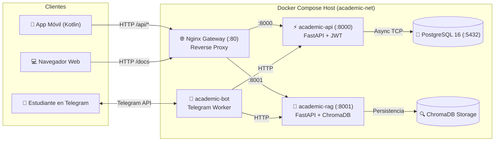

# Academic Platform

> Repositorio paraguas y orquestador central del ecosistema **Academic**: integra la API REST, el motor de IA/RAG, el bot conversacional de Telegram y el Gateway Nginx con un solo comando `docker compose up`.

[](https://www.docker.com/)
[](https://www.postgresql.org/)
[](https://fastapi.tiangolo.com/)
[](https://www.trychroma.com/)
[](https://python-telegram-bot.org/)
[](LICENSE)

---

## Estado del Proyecto
✅ **Listo para despliegue y desarrollo local integrado.**
- [x] `docker-compose.yml` que levanta PostgreSQL 16, API, RAG, Bot y Gateway Nginx
- [x] Diagrama de arquitectura de microservicios y flujo de datos
- [x] Guía de instalación paso a paso probada desde cero (Linux, macOS y Windows)
- [x] Scripts automatizados de inicialización de base de datos (`scripts/init-db.*`)
- [x] Scripts de diagnóstico y healthcheck en tiempo real (`scripts/healthcheck.*`)
- [x] Enlaces y referencias a los repositorios de cada componente

---

## Repositorios y Componentes del Ecosistema

El ecosistema **Academic** está organizado en microservicios modulares e independientes bajo la organización `academic-dev`:

| Componente | Repositorio | Tecnología | Rol en la Plataforma |
| :--- | :--- | :--- | :--- |
| **Orquestador** | `academic-platform` | Docker Compose / Nginx | Orquestación de contenedores, redes y proxy unificado |
| **API Principal** | [`academic-api`](https://github.com/academi-dev/academic-api) | FastAPI, SQLAlchemy Async, Alembic | Lógica de negocio, CRUD materias/tareas, autenticación JWT |
| **Motor RAG** | [`academic-rag`](https://github.com/academi-dev/academic-rag) | FastAPI, ChromaDB, LangChain | Búsqueda semántica y asistencia con IA sobre reglamentos |
| **Bot Estudiantes**| [`academic-bot`](https://github.com/academi-dev/academic-bot) | `python-telegram-bot` | Asistente conversacional de Telegram para alumnos |
| **App Móvil** | [`academic-mobile`](https://github.com/academi-dev/academic-mobile)| Android / Kotlin / Jetpack Compose | Aplicación móvil nativa para estudiantes |

---

## Arquitectura del Sistema



Para una explicación detallada de cada capa, protocolos y modelos de datos, consulta la [Documentación de Arquitectura](docs/arquitectura.md).

---

## Stack Tecnológico

- **Contenedores y Redes:** Docker 24+, Docker Compose v2, Nginx 1.25 Alpine
- **Backend:** Python 3.11+, FastAPI, Uvicorn, Pydantic v2
- **Persistencia Relacional:** PostgreSQL 16, SQLAlchemy 2.0 Async, Alembic, asyncpg
- **Búsqueda Vectorial e IA:** ChromaDB, LangChain, Embeddings
- **Mensajería e Interacción:** python-telegram-bot v20+
- **Seguridad:** Tokens JWT (HS256) con expiración corta, UUIDs v4 para todos los identificadores, fechas ISO 8601 en UTC

---

## Cómo Correrlo

### Requisitos Previos
- [Docker Desktop](https://www.docker.com/products/docker-desktop/) instalado y en ejecución (en Windows habilitar el backend WSL 2).
- Git.
- Opcional: Curl para pruebas de consola.

### 1. Clonar el repositorio
Ubícate en tu carpeta de proyectos donde residen los repositorios hermanos:
```bash
cd "academic-platform"
```

### 2. Configurar variables de entorno
Crea tu archivo `.env` a partir de la plantilla:
```bash
# En Linux / macOS / Git Bash:
cp .env.example .env

# En Windows PowerShell:
Copy-Item .env.example .env
```
> **Nota:** Abre `.env` y coloca tu `TELEGRAM_BOT_TOKEN` obtenido de [@BotFather](https://t.me/BotFather) y tu `OPENAI_API_KEY` (opcional).

### 3. Iniciar todos los contenedores
```bash
docker compose up -d --build
```
Este comando construirá las imágenes locales de `academic-api`, `academic-rag` y `academic-bot` resolviendo las rutas relativas a las carpetas hermanas del proyecto y descargará las imágenes oficiales de PostgreSQL y Nginx.

### 4. Inicializar la base de datos y migraciones
Ejecuta el script de inicialización para esperar a que PostgreSQL esté saludable y aplicar las migraciones de Alembic:
```bash
# En Linux / macOS / Git Bash:
chmod +x scripts/init-db.sh
./scripts/init-db.sh

# En Windows PowerShell:
.\scripts\init-db.ps1
```

### 5. Verificar la salud de la plataforma
Ejecuta el script de diagnóstico para verificar que todos los microservicios respondan correctamente:
```bash
# En Linux / macOS / Git Bash:
chmod +x scripts/healthcheck.sh
./scripts/healthcheck.sh

# En Windows PowerShell:
.\scripts\healthcheck.ps1
```

---

## Endpoints y Accesos Rápidos

| Servicio | URL Local | Descripción |
| :--- | :--- | :--- |
| **API Gateway** | [http://localhost/health](http://localhost/health) | Endpoint de salud del Reverse Proxy Nginx |
| **Documentación Swagger** | [http://localhost/docs](http://localhost/docs) | Interfaz interactiva OpenAPI de `academic-api` |
| **Documentación ReDoc** | [http://localhost/redoc](http://localhost/redoc) | Documentación estructurada de la API |
| **API REST Directa** | [http://localhost:8000/api/v1/health](http://localhost:8000/api/v1/health) | Acceso directo a FastAPI |
| **Servicio RAG** | [http://localhost:8001/health](http://localhost:8001/health) | Acceso directo al motor RAG |
| **Base de Datos** | `localhost:5432` | Conexión PostgreSQL (usuario: `academic_user`) |

---

## Comandos Útiles

```bash
# Ver estado de los contenedores
docker compose ps

# Ver logs en tiempo real de todos los servicios
docker compose logs -f

# Ver logs de un servicio específico (ej. el bot de Telegram)
docker compose logs -f academic-bot

# Reiniciar un servicio tras cambios de código
docker compose restart academic-api

# Detener todos los contenedores conservando los datos en los volúmenes
docker compose down

# Detener contenedores y eliminar volúmenes (¡ATENCIÓN: BORRA LA BASE DE DATOS!)
docker compose down -v
```

---

## Estructura del Repositorio

```text
academic-platform/
├── .env.example              # Plantilla de variables de entorno documentada
├── .gitignore                # Reglas de exclusión de Git
├── docker-compose.yml        # Orquestador multi-contenedor principal
├── LICENSE                   # Licencia MIT
├── README.md                 # Documentación general del repositorio
├── docs/
│   └── arquitectura.md       # Especificación técnica y diagramas Mermaid
├── nginx/
│   └── nginx.conf            # Configuración de reverse proxy y gateway
└── scripts/
    ├── healthcheck.sh        # Healthcheck HTTP y estado en Bash
    ├── healthcheck.ps1       # Healthcheck HTTP y estado en PowerShell
    ├── init-db.sh            # Espera a PostgreSQL y migración Alembic en Bash
    └── init-db.ps1           # Espera a PostgreSQL y migración Alembic en PowerShell
```

---

## Equipo

Desarrollado con dedicación por el equipo de **`academic-dev`**:
- **Jean Mena** — [@hilton45](https://github.com/hilton45)
- **Eyfer Mena** — [@eyfer3174-commits](https://github.com/eyfer3174-commits-commits)

---

## Licencia

Distribuido bajo la Licencia **MIT**. Consulta el archivo [LICENSE](LICENSE) para más detalles.
