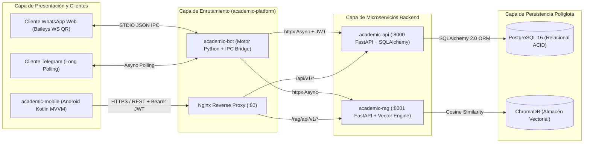

# 🎓 Documento Técnico de Arquitectura e Ingeniería de Software — Ecosistema *Academic*

**Organización:** [`academi-dev`](https://github.com/academi-dev)  
**Autores:** Jean Mena (`@hilton45`) · Eyfer Mena (`@eyfer3174-commits-commits`)  
**Arquitectura:** Microservicios Distribuidos API-First, Inteligencia Artificial Generativa/Extractiva (RAG), Mensajería Omnicanal (WhatsApp QR + Telegram) y Cliente Móvil Nativo Android (MVVM).

---

## 1. Resumen Ejecutivo

**Academic** es una plataforma distribuida de gestión académica e inteligencia documental diseñada bajo principios de **Ingeniería de Software Moderna**, **Arquitectura Limpia (Clean Architecture)** y **Diseño Guiado por Contratos (Contract-First API)**.

El sistema resuelve la fragmentación de la información estudiantil unificando en un ecosistema desacoplado de **cinco repositorios independientes**:
1. **Gestión transaccional de asignaturas y entregas académicas** mediante una API RESTful con control de acceso basado en roles (**RBAC**) y aislamiento estricto por propietario (*Multi-Tenant Row-Level Isolation*).
2. **Recuperación Aumentada por Generación (RAG)** sobre material bibliográfico en formato PDF, capaz de indexar fragmentos vectoriales y responder consultas en lenguaje natural con **trazabilidad exacta de fuente y número de página**.
3. **Acceso multicanal ubicuo** a través de una aplicación nativa Android (**Kotlin + MVVM + Material Design 3**) y un motor conversacional bimodal para **WhatsApp Web (vía protocolo WebSockets QR)** y **Telegram**.

---

## 2. Arquitectura del Sistema y Topología de Red

---

## 3. Especificación Técnica por Componente

### 3.1. Microservicio Transaccional Core: `academic-api`
- **Stack:** FastAPI (ASGI / Uvicorn), SQLAlchemy 2.0 ORM, Alembic y Pydantic v2.
- **Identificadores Universales (UUIDv4):** Tipo personalizado `GUID(TypeDecorator)` compatible con PostgreSQL (`UUID` nativo) y SQLite (`CHAR(36)`), mitigando ataques de enumeración secuencial (*IDOR*).
- **Seguridad Criptográfica y Autenticación:**
  - *Hashing:* Algoritmo **Bcrypt** con *salt* único por usuario.
  - *Doble Token JWT (`HS256`):* `access_token` de corta vida (30 min) y `refresh_token` (7 días) con verificación estricta de la reclamación `type`.
  - *Prevención de Mass Assignment:* El esquema `RegistroRequest` bloquea la inyección del campo `rol` y asigna `UserRole.ESTUDIANTE` en la capa de dominio.

### 3.2. Motor de Inteligencia Documental: `academic-rag`
- **Ingesta y Fragmentación:** Extracción paginada con `PyPDF2` y segmentación con solapamiento (`CHUNK_SIZE=500`, `CHUNK_OVERLAP=50`) preservando número de página y posición ordinal.
- **Búsqueda Semántica:** Indexación vectorial en `ChromaDB` con `sentence-transformers` (`all-MiniLM-L6-v2`) y respaldo vectorial L2-normalizado con similitud coseno.
- **Citación Verificable:** Cada respuesta incluye la lista estructurada de citas (`documento`, `pagina`, `texto`, `relevancia`).

### 3.3. Agente Conversacional Omnicanal (WhatsApp QR + Telegram): `academic-bot`
- **Telegram:** `python-telegram-bot` v20+ asíncrono con `ConversationHandler` y `APScheduler`.
- **WhatsApp Web (QR):** Conector `@whiskeysockets/baileys` en Node.js comunicado por puente IPC `STDIO JSON` con la máquina de estados finitos (`WhatsAppCommandProcessor`) en Python, con sesiones aisladas por número (`remoteJid`).

### 3.4. Aplicación Móvil Nativa Android: `academic-mobile`
- **Arquitectura:** MVVM con `StateFlow<UiState<T>>`, `ViewBinding` y `Material Design 3`.
- **Seguridad y Red:** `Retrofit 2` + `OkHttp 4` con `AuthInterceptor`, renovación transparente de tokens en `TokenAuthenticator` y almacenamiento cifrado con `EncryptedSharedPreferences` (Android Keystore AES-256).

### 3.5. Orquestación e Infraestructura: `academic-platform`
- **Docker Compose & Nginx:** Orquestación de 5 contenedores con `healthcheck`, red bridge `academic-net`, volúmenes persistentes y gateway unificado en Nginx 1.25.
