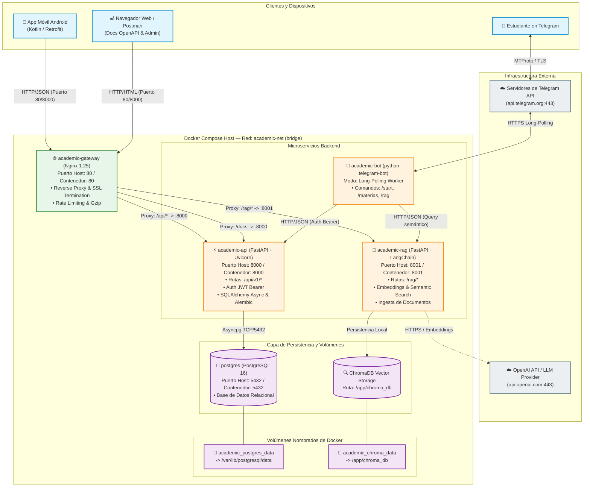
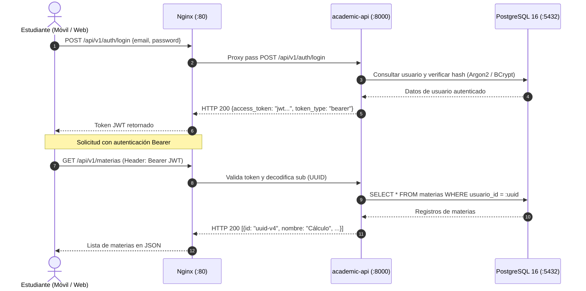
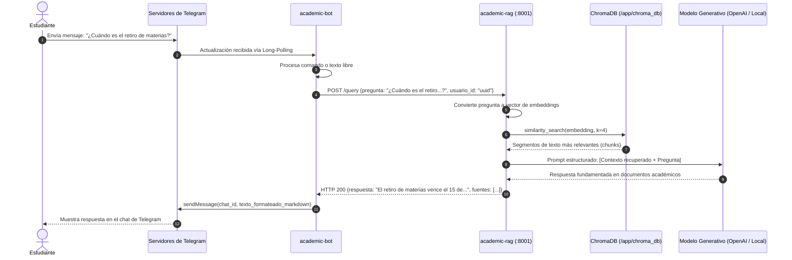

# Arquitectura del Sistema Academic Platform

> **Organización:** `academic-dev`  
> **Equipo de Desarrollo:**  
> - Jean Mena ([@hilton45](https://github.com/hilton45))  
> - Eyfer Mena ([@eyfer3174-commits](https://github.com/eyfer3174-commits))  
> **Versión:** 1.0.0 — Octubre 2026  

---

## 1. Visión General del Sistema

**Academic** es una plataforma integral de gestión universitaria y académica diseñada bajo una arquitectura de microservicios orientada a contenedores con Docker. Permite a los estudiantes administrar sus materias, horarios, calificaciones, evaluaciones y tareas, además de contar con un asistente conversacional inteligente en Telegram potenciado por RAG (*Retrieval-Augmented Generation*) para responder dudas sobre reglamentos, planes de estudio y contenidos académicos.

El sistema orquesta de forma desacoplada los siguientes servicios:
1. **`academic-gateway` (Nginx):** Punto de entrada unificado y reverse proxy para clientes externos.
2. **`academic-api` (FastAPI):** Núcleo de servicios REST para la lógica de negocio académica y autenticación JWT.
3. **`academic-rag` (FastAPI + ChromaDB):** Motor de búsqueda semántica y generación aumentada por recuperación.
4. **`academic-bot` (Telegram Bot):** Interfaz conversacional accesible para los alumnos.
5. **`academic-mobile` (Kotlin/Android):** Aplicación móvil nativa para la experiencia del estudiante.
6. **`postgres` (PostgreSQL 16):** Base de datos relacional para entidades transaccionales.
7. **`chroma-data` (ChromaDB Vector Store):** Persistencia de colecciones vectoriales y embeddings.

---

## 2. Diagrama de Arquitectura de Servicios

El siguiente diagrama ilustra la topología de red, los contenedores, los puertos expuestos, los protocolos de comunicación y el aislamiento mediante la red interna `academic-net`:



---

## 3. Diagramas de Flujo de Datos

### 3.1 Flujo de Autenticación y Consumo de la API

Los clientes obtienen un token JWT con tiempo de expiración corto (30 minutos) que deben enviar en la cabecera `Authorization: Bearer <token>`:



---

### 3.2 Flujo de Consulta al Asistente Inteligente (RAG vía Bot)

Cuando un estudiante realiza una pregunta compleja al bot de Telegram:



---

## 4. Detalle de Componentes y Microservicios

### 4.1 `academic-gateway` (Nginx Reverse Proxy)
- **Tecnología:** Nginx 1.25 Alpine.
- **Puerto:** `80` (mapeable mediante la variable `GATEWAY_PORT`).
- **Responsabilidades:**
  - Enrutamiento transparente hacia los servicios internos sin exponer múltiples puertos en el firewall.
  - Proxy hacia `academic-api` en `/api/` y hacia `academic-rag` en `/rag/`.
  - Exposición de la documentación Swagger/OpenAPI en `/docs`, `/redoc` y `/openapi.json`.
  - Endpoint de salud unificado en `/health`.
  - Inyección de cabeceras de seguridad (`X-Frame-Options`, `X-Content-Type-Options`, `X-XSS-Protection`).
  - Optimización con compresión Gzip para transferencias JSON rápidas en redes móviles.

### 4.2 `academic-api` (API REST Principal)
- **Tecnología:** Python 3.11+ / FastAPI / Uvicorn.
- **Puerto:** `8000` (interno y expuesto como `API_PORT`).
- **Patrón de Arquitectura:** Layered Architecture (Routers, Services, Repositories, Schemas, Models).
- **ORM y Migraciones:** SQLAlchemy 2.0 Async + Alembic.
- **Convenciones Estrictas:**
  - **Identificadores:** UUID v4 en todos los registros para evitar ataques de enumeración y facilitar sincronizaciones móviles.
  - **Fechas:** Formato ISO 8601 en tiempo universal coordinado UTC (`YYYY-MM-DDTHH:MM:SSZ`).
  - **Rutas:** En plural, minúsculas y versionadas (ejemplo: `/api/v1/materias`, `/api/v1/tareas`, `/api/v1/calificaciones`).
  - **Paginación:** Basada en parámetros `limit` (por defecto 20, máximo 100) y `offset`.
  - **Formato Estándar de Error:**
    ```json
    {
      "error": {
        "codigo": "RECURSO_NO_ENCONTRADO",
        "mensaje": "La tarea con el identificador solicitado no existe."
      }
    }
    ```
  - **Códigos de Estado HTTP:**
    - `200 OK`: Consulta o actualización exitosa.
    - `201 Created`: Creación de recurso exitosa.
    - `204 No Content`: Eliminación exitosa sin cuerpo.
    - `400 Bad Request`: Petición malformada o parámetros inválidos.
    - `401 Unauthorized`: Token ausente, expirado o inválido.
    - `403 Forbidden`: Credenciales válidas pero sin permisos sobre el recurso.
    - `404 Not Found`: Recurso no encontrado.
    - `409 Conflict`: Conflicto de unicidad (ej. correo ya registrado).
    - `422 Unprocessable Entity`: Error de validación semántica de Pydantic.
    - `500 Internal Server Error`: Fallo no controlado del servidor.

### 4.3 `academic-rag` (Servicio de Búsqueda Aumentada por Recuperación)
- **Tecnología:** Python 3.11+ / FastAPI / LangChain / ChromaDB.
- **Puerto:** `8001` (interno y expuesto como `RAG_PORT`).
- **Almacenamiento Vectorial:** Directorio local `/app/chroma_db` respaldado en el volumen persistente `chroma-data`.
- **Funcionalidades:**
  - Ingesta y partición (*chunking*) de documentos académicos (PDFs, reglamentos, cronogramas).
  - Generación de vectores de características semánticas (embeddings).
  - Búsqueda de similitud por coseno (*k-nearest neighbors*).
  - Ensamblado de prompts con contexto y generación de respuestas fundamentadas.

### 4.4 `academic-bot` (Bot de Telegram)
- **Tecnología:** Python 3.11+ / `python-telegram-bot` (v20+ asíncrono).
- **Modo de Conexión:** Long-Polling hacia los servidores de Telegram (no requiere IP pública ni certificado SSL para operar localmente).
- **Dependencias:** Requiere que `academic-api` y `academic-rag` estén operativos.
- **Funciones:**
  - Autenticación y vinculación de cuenta de Telegram con el perfil universitario del estudiante.
  - Consulta interactiva de materias, horarios y tareas pendientes.
  - Notificaciones de entregas próximas.
  - Consultas inteligentes en lenguaje natural contra el servicio RAG.

### 4.5 `postgres` (Base de Datos Relacional)
- **Imagen:** `postgres:16-alpine`.
- **Puerto:** `5432`.
- **Persistencia:** Volumen nombrado `postgres-data` mapeado a `/var/lib/postgresql/data`.
- **Mecanismo de Healthcheck:** Ejecución de `pg_isready -U ${POSTGRES_USER} -d ${POSTGRES_DB}` cada 10 segundos para garantizar que los servicios dependientes solo arranquen cuando el motor esté listo.

---

## 5. Topología de Red y Volúmenes de Docker

### Red: `academic-net`
- **Tipo:** `bridge` personalizado.
- **Ventajas:**
  - Permite la resolución automática de nombres DNS entre contenedores (`http://academic-api:8000`, `http://academic-rag:8001`, `postgres:5432`).
  - Aísla la comunicación interna del resto de contenedores ajenos al proyecto en el host.

### Volúmenes Persistentes
| Nombre del Volumen | Contenedor | Ruta de Montaje | Propósito |
| :--- | :--- | :--- | :--- |
| `postgres-data` (`academic_postgres_data`) | `postgres` | `/var/lib/postgresql/data` | Persistencia del motor relacional PostgreSQL 16 |
| `chroma-data` (`academic_chroma_data`) | `academic-rag` | `/app/chroma_db` | Almacenamiento de índices vectoriales de ChromaDB |

---

## 6. Variables de Entorno y Configuración

El orquestador utiliza una plantilla centralizada `.env.example` que debe ser copiada a `.env`:

| Variable | Tipo / Valor por Defecto | Descripción |
| :--- | :--- | :--- |
| `POSTGRES_DB` | `academic_db` | Nombre de la base de datos principal |
| `POSTGRES_USER` | `academic_user` | Usuario de PostgreSQL |
| `POSTGRES_PASSWORD` | *(secreto)* | Contraseña del usuario de base de datos |
| `POSTGRES_PORT` | `5432` | Puerto expuesto de PostgreSQL en el host |
| `SECRET_KEY` | *(secreto)* | Clave de firma simétrica para tokens JWT |
| `ALGORITHM` | `HS256` | Algoritmo criptográfico del JWT |
| `ACCESS_TOKEN_EXPIRE_MINUTES`| `30` | Minutos de validez para cada token de acceso |
| `TELEGRAM_BOT_TOKEN` | *(secreto)* | Token otorgado por @BotFather en Telegram |
| `OPENAI_API_KEY` | *(opcional)* | Clave de OpenAI para embeddings y LLM |
| `API_PORT` | `8000` | Puerto en el host para `academic-api` |
| `RAG_PORT` | `8001` | Puerto en el host para `academic-rag` |
| `GATEWAY_PORT` | `80` | Puerto en el host para el Gateway Nginx |
| `ENVIRONMENT` | `development` | Entorno de despliegue (`development`/`production`) |

---

## 7. Scripts de Automatización y Operación

El repositorio provee herramientas para administración y diagnóstico tanto en Linux/macOS como en Windows PowerShell:

1. **`scripts/init-db.sh` / `scripts/init-db.ps1`:**
   - Realiza polling con `pg_isready` hasta confirmar que PostgreSQL está saludable.
   - Dispara automáticamente `alembic upgrade head` dentro del contenedor `academic-api`.
2. **`scripts/healthcheck.sh` / `scripts/healthcheck.ps1`:**
   - Inspecciona y prueba mediante llamadas HTTP cada endpoint de salud.
   - Informa los códigos de respuesta y la latencia en milisegundos.
   - Valida el estado de vida de los contenedores Docker en tiempo real.

---

## 8. Ciclo de Vida y Despliegue

### Inicio Rápido
```bash
# 1. Clonar el repositorio y ubicarse en academic-platform
cd "academic-platform"

# 2. Configurar el archivo de entorno
cp .env.example .env

# 3. Construir y levantar todos los servicios en segundo plano
docker compose up -d --build

# 4. Inicializar esquema de base de datos y migraciones
./scripts/init-db.sh      # En Linux/macOS/Git Bash
.\scripts\init-db.ps1     # En Windows PowerShell

# 5. Comprobar salud del ecosistema completo
./scripts/healthcheck.sh  # En Linux/macOS/Git Bash
.\scripts\healthcheck.ps1 # En Windows PowerShell
```

### URLs de Acceso Local
- **Gateway Unificado:** `http://localhost/`
- **Documentación Swagger API:** `http://localhost/docs` o `http://localhost:8000/docs`
- **Documentación ReDoc:** `http://localhost/redoc`
- **Servicio RAG:** `http://localhost/rag/health` o `http://localhost:8001/health`
- **Healthcheck Gateway:** `http://localhost/health`
